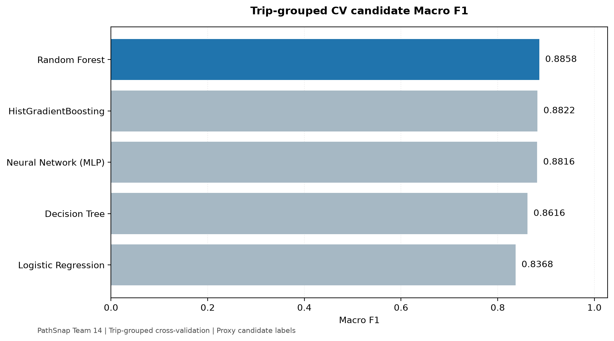
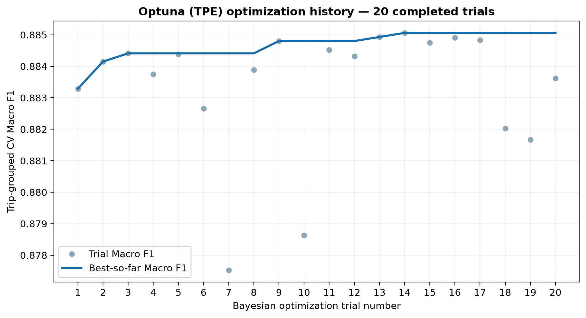

# PathSnap

### Machine Learning–Driven GPS Map Matching and Route Reconstruction

GPS traces are not always precise. In dense urban areas, near parallel roads, or where satellite signals are obstructed, recorded coordinates can fall several metres away from the road a vehicle actually travelled. **PathSnap** addresses this problem by combining geographic feature engineering, machine learning and sequence-based route decoding to identify plausible road segments from noisy GPS observations.

The project follows a modular pipeline: road-candidate generation, candidate scoring with a trained classifier, route-sequence reconstruction using a Hidden Markov Model (HMM) and the Viterbi algorithm, and geographic visualization for inspecting the results.

## How it works

```text
Noisy GPS observations (.track)       Road network (.nodes, .arcs)
               \                           /
                \                         /
                 v                       v
                 Data loading and validation
                             |
                             v
                  Nearby road candidates
                             |
                             v
               Geometric and motion features
                             |
                             v
                ML candidate-road scoring
                             |
                             v
               HMM / Viterbi route decoding
                             |
                             v
              Predicted road-segment sequence
                             |
                             v
              Map visualization and evaluation
```

Each GPS observation is matched against several nearby candidate road segments. The classifier assigns a score to each candidate. Rather than independently choosing the highest-scoring road at every point, the sequence-decoding stage considers transitions between candidates to produce a more coherent route.

## Key capabilities

- **Road-candidate generation:** Identify plausible nearby road segments for each GPS observation.
- **Geospatial feature engineering:** Describe candidate roads using distance, heading, movement and segment geometry.
- **Comparative model training:** Train and evaluate multiple classification algorithms on a consistent candidate dataset.
- **Bayesian hyperparameter search:** Optimize the selected model with Optuna and compare tuned results against the untuned baseline.
- **Sequence-aware reconstruction:** Use HMM/Viterbi to incorporate transition plausibility into route selection.
- **Visual and quantitative analysis:** Generate comparison charts, confusion matrices, ROC and precision–recall plots, and trip-wise robustness metrics.
- **Integration-friendly inference:** Export per-candidate model scores for downstream route decoding and application interfaces.

## Dataset

The dataset is organized by vehicle trip. Each trip includes four files:

| File | Description |
| --- | --- |
| `.track` | Recorded GPS coordinates and timestamps |
| `.nodes` | Road-network node coordinates |
| `.arcs` | Road segments and their endpoint node references |
| `.route` | Reference road-segment sequence, used for label construction or permitted evaluation |

The development setup separates **80 training trips**, **10 student-testing trips** and **10 reserved evaluator-testing trips**. The evaluator partition must not be used for model fitting, hyperparameter selection or feature-label construction.

The finalized training handoff contains:

| Training-data measure | Count |
| --- | ---: |
| Trips | 80 |
| GPS observations | 135,502 |
| Candidate roads per observation | 5 |
| Candidate-level records | **677,510** |
| Input features | 8 |

Candidate records are not independent GPS journeys: five candidate rows represent alternative road matches for one observation. Supervised candidate labels are produced through approximate reference-route alignment; they should not be described as exact point-level ground truth.

## Feature engineering

The candidate classifier uses the following eight input features:

| Feature | What it describes |
| --- | --- |
| `distance_m` | Distance from the GPS point to a candidate road segment |
| `heading_difference` | Alignment between estimated travel direction and road direction |
| `speed_mps` | Estimated vehicle movement speed |
| `time_gap_s` | Time elapsed between adjacent GPS observations |
| `segment_length_m` | Length of the candidate road segment |
| `candidate_rank` | Candidate's position in the nearby-road ranking |
| `projection_fraction` | Location of the GPS projection along the segment |
| `heading_reliable` | Indicator of whether the heading estimate is trustworthy |

Missing or non-finite feature values are handled within the fitted preprocessing pipeline. Identifiers such as trip IDs, observation indices and arc IDs are retained for grouping and reconstruction, not used as predictive numeric features.

## Model development and evaluation

Five classifiers were evaluated using **three-fold cross-validation grouped by trip**, avoiding overlap of a trip between the training and validation portions of a fold.

| Model | CV Macro F1 | Observation Top-1 accuracy | CV log loss |
| --- | ---: | ---: | ---: |
| **Random Forest** | **0.8858** | **82.25%** | 0.1843 |
| Histogram Gradient Boosting | 0.8822 | 81.97% | **0.1699** |
| Multi-Layer Perceptron | 0.8816 | 82.04% | 0.1708 |
| Decision Tree | 0.8616 | 81.30% | 0.3269 |
| Logistic Regression | 0.8368 | 80.52% | 0.2810 |

**Random Forest** was selected by the predefined Macro F1 comparison criterion. The Bayesian hyperparameter search evaluated **20 configurations**, each with three grouped-validation folds. The best tuned Macro F1 was **0.8851**, slightly below the untuned baseline's **0.8858**; the baseline was therefore retained as the deployment model.





Further analyses include classifier confusion matrices, ROC and precision–recall comparisons, probability-output verification and out-of-fold trip-level robustness statistics. The mean of per-trip Top-1 proxy accuracies was **84.78%** (unweighted across trips), illustrating how performance can vary by trajectory.

> **Metric scope:** The figures above are candidate-classification results on held-out training trips using approximate reference-alignment labels. They are **not** the accuracy of a fully reconstructed HMM route and **not** results from the reserved evaluator dataset.

## Route reconstruction

Candidate-level classification and route-level map matching solve related but distinct tasks:

1. The ML model returns class-1 scores for each nearby candidate road segment.
2. Emission scores express how well individual road candidates fit the GPS observations.
3. Transition scores assess the plausibility of moving between road segments.
4. Viterbi decoding selects a high-scoring sequence of road candidates across the trajectory.
5. The resulting road sequence can be compared with classifier-only selections and visualized on a map.

Per-candidate classifier probabilities do **not** need to sum to one within an observation. They serve as inputs to the sequence decoder and are not themselves a complete route prediction.

## Repository layout

```text
scripts/                     Training, tuning and evaluation utilities
src/pathsnap/                Data, geometry, features and route-decoding modules
src/pathsnap/api/            API integration modules
src/pathsnap/ui/             User-interface modules
results/handoff/             Model comparisons and optimization summaries
results/presentation_graphs/ Evaluation charts and confusion matrices
results/trip_robustness/     Per-trip cross-validation analysis
results/ml_inference_audit/  Candidate probability and schema checks
docs/                        Supporting technical notes
artifacts/handoff/           Locally saved model binaries (not tracked in Git)
data/handoff/                Locally prepared candidate-feature data
```

Large model binaries and raw datasets are intended to be managed separately from the source repository.

## Getting started

Use Python in a virtual environment, then install the project's dependencies:

```bash
git clone https://github.com/karan21v/ML_Hackathon_Team14.git
cd ML_Hackathon_Team14
python3 -m venv .venv
source .venv/bin/activate
pip install -r requirements.txt
```

The commands below assume that the prepared candidate-feature CSV is available at `data/handoff/candidate_features_handoff.csv`.

**Train and compare all five models:**

```bash
python -u scripts/train_handoff_csv.py \
  --csv data/handoff/candidate_features_handoff.csv \
  --max-obs-per-trip 0 \
  --folds 3
```

**Run 20 Bayesian optimization trials:**

```bash
python -u scripts/tune_handoff_csv.py --trials 20
```

**Verify the saved model and generate evaluation evidence:**

```bash
python scripts/verify_ml_inference.py
python scripts/pathsnap_make_evaluation_plots.py --confusion
python scripts/evaluate_trip_robustness.py \
  --csv data/handoff/candidate_features_handoff.csv \
  --max-obs-per-trip 0 --folds 3 --model random_forest
```

The saved inference bundle uses `artifacts/handoff/deploy_model.joblib` and records the expected input feature ordering. When integrating the classifier into a decoder or API, load the saved preprocessing/model pipeline and pass feature columns in the stored order.

## Evaluation principles

- Split by **trip**, not randomly by candidate row, to avoid optimistic results from near-duplicate observations.
- Use reference-route information for supervised label construction and authorized scoring, **never** as an input to prediction on an unseen trip.
- Evaluate candidate ranking separately from full-route continuity and reference-route agreement.
- Keep student-testing and reserved evaluator-testing partitions distinct from the training data.
- Report both average metrics and difficult-trip behavior; a strong overall score can conceal individual failures.

## Technology

Python · pandas · NumPy · scikit-learn · Optuna · joblib · geospatial processing · HMM/Viterbi · Folium · FastAPI

---

**PathSnap explores the combination of local road-candidate confidence and global route consistency to turn imperfect GPS traces into more plausible road trajectories.**
